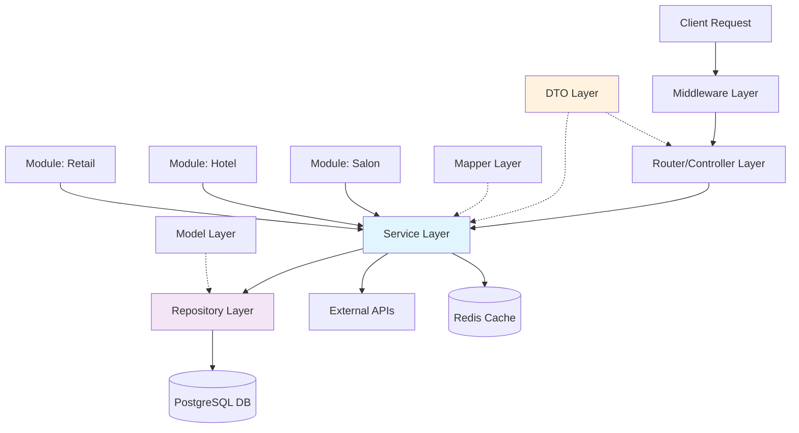

# Contributing Guidelines

Thank you for considering contributing to this project! 🚀

This is a **multi-tenant SaaS platform** supporting various organization types including **Salon**, **Retail**, and **Hotel** management systems. This guide will help you understand our architecture, development workflow, and contribution standards.

---

## 📋 Table of Contents

- [Getting Started](#-getting-started)
- [Application Architecture](#-application-architecture)
- [Project Structure](#-project-structure)
- [Development Workflow](#-development-workflow)
- [Coding Standards](#-coding-standards)
- [Testing Guidelines](#-testing-guidelines)
- [Submitting Changes](#-submitting-changes)

---

## 🚀 Getting Started

### Prerequisites

- **Go** 1.21+ 
- **PostgreSQL** 13+
- **Redis** (for caching/sessions)
- **Docker** & **Docker Compose** (recommended)
- **Git**

### Local Setup

1. **Clone the repository**
   ```bash
   git clone <repository-url>
   cd <project-name>
   ```

2. **Environment Setup**
   ```bash
   cp .env.example .env
   # Configure your database and other environment variables
   ```

3. **Install dependencies**
   ```bash
   go mod download
   ```

4. **Database Setup**
   ```bash
   # Using Docker Compose
   docker-compose up -d postgres redis
   
   # Run migrations
   go run cmd/migrate/main.go
   ```

5. **Run the application**
   ```bash
   go run cmd/server/main.go
   ```

---

## 🧠 Application Architecture

Our application follows a **Clean Architecture** pattern with clear separation of concerns:



### Layer Responsibilities

| Layer | Responsibility | Example |
|-------|---------------|---------|
| **Controllers** | HTTP request handling, validation, response formatting | `UserController.CreateUser()` |
| **Services** | Business logic, orchestration, cross-cutting concerns | `UserService.RegisterUser()` |
| **Repositories** | Data access, query optimization, database operations | `UserRepository.FindByEmail()` |
| **Models** | Data structures, GORM annotations, database schema | `User`, `Organization`, `Booking` |
| **DTOs** | Request/response validation, API contracts | `CreateUserRequest`, `UserResponse` |
| **Mappers** | Data transformation between layers | `UserMapper.ToDTO()`, `FromDTO()` |
| **Modules** | Organization-type specific business logic | `salon/`, `hotel/`, `retail/` |

---

## 📦 Project Structure

```
├── cmd/                    # Application entry points
│   ├── server/            # Main server application
│   └── migrate/           # Database migration tool
├── internal/              # Private application code
│   ├── config/           # Configuration management
│   ├── middleware/       # HTTP middleware
│   ├── models/           # Database models (GORM)
│   ├── dto/              # Data Transfer Objects
│   ├── mappers/          # DTO ↔ Model conversion
│   ├── repositories/     # Data access layer
│   ├── services/         # Business logic layer
│   ├── controllers/      # HTTP handlers
│   ├── routers/          # Route definitions
│   └── modules/          # Organization-specific logic
│       ├── salon/        # Salon management features
│       ├── hotel/        # Hotel management features
│       └── retail/       # Retail management features
├── pkg/                   # Public/shared packages
│   ├── utils/            # Utility functions
│   ├── errors/           # Custom error types
│   └── validator/        # Custom validation rules
├── migrations/           # Database migrations
├── tests/               # Test files
│   ├── unit/           # Unit tests
│   ├── integration/    # Integration tests
│   └── fixtures/       # Test data
├── docs/               # Documentation
├── scripts/            # Build/deployment scripts
└── docker/             # Docker configurations
```

---

## 🔄 Development Workflow

### 1. Branch Naming Convention

- **Feature**: `feature/add-booking-system`
- **Bugfix**: `bugfix/fix-user-validation`
- **Hotfix**: `hotfix/critical-payment-issue`
- **Chore**: `chore/update-dependencies`

### 2. Commit Message Format

Follow [Conventional Commits](https://conventionalcommits.org/):

```
<type>[optional scope]: <description>

[optional body]

[optional footer(s)]
```

**Examples:**
```
feat(auth): add JWT token refresh mechanism
fix(booking): resolve double-booking validation issue
docs(api): update authentication endpoints documentation
test(user): add unit tests for user service
```

### 3. Adding New Features

When adding a new feature, follow this order:

1. **Model** - Define database structure
2. **DTO** - Create request/response structures
3. **Mapper** - Handle conversions
4. **Repository** - Implement data access
5. **Service** - Add business logic
6. **Controller** - Create HTTP handlers
7. **Router** - Define routes
8. **Tests** - Write comprehensive tests

### 4. Module-Specific Development

For organization-type specific features:

```go
// Example: Adding salon-specific appointment booking
internal/modules/salon/
├── models/
│   └── appointment.go
├── services/
│   └── appointment_service.go
├── controllers/
│   └── appointment_controller.go
└── routers/
    └── appointment_routes.go
```

---

## 📝 Coding Standards

### Go Style Guidelines

- Follow [Effective Go](https://golang.org/doc/effective_go.html)
- Use `gofmt` and `golint`
- Prefer composition over inheritance
- Use meaningful variable and function names
- Add comments for exported functions and complex logic

### Naming Conventions

```go
// Models - PascalCase
type User struct {}
type BookingHistory struct {}

// Services - Descriptive names
type UserService interface {}
type BookingManagementService interface {}

// DTOs - Clear purpose
type CreateUserRequest struct {}
type UserListResponse struct {}

// Repository methods - Clear actions
func (r *UserRepository) FindByEmail(email string) (*User, error)
func (r *UserRepository) CreateWithTx(tx *gorm.DB, user *User) error
```

### Error Handling

```go
// Use custom error types
type ValidationError struct {
    Field   string
    Message string
}

// Repository layer - return errors, don't log
func (r *UserRepository) FindByID(id uint) (*User, error) {
    var user User
    if err := r.db.First(&user, id).Error; err != nil {
        return nil, err
    }
    return &user, nil
}

// Service layer - handle business logic errors
func (s *UserService) GetUser(id uint) (*dto.UserResponse, error) {
    user, err := s.repo.FindByID(id)
    if errors.Is(err, gorm.ErrRecordNotFound) {
        return nil, &NotFoundError{Resource: "user"}
    }
    if err != nil {
        return nil, err
    }
    return s.mapper.ToUserResponse(user), nil
}
```

---

## 🧪 Testing Guidelines

### Test Structure

```go
func TestUserService_CreateUser(t *testing.T) {
    tests := []struct {
        name        string
        input       *dto.CreateUserRequest
        setupMocks  func(*MockUserRepository)
        expected    *dto.UserResponse
        expectedErr error
    }{
        {
            name: "successful user creation",
            input: &dto.CreateUserRequest{
                Email: "test@example.com",
                Name:  "Test User",
            },
            setupMocks: func(mockRepo *MockUserRepository) {
                mockRepo.EXPECT().Create(gomock.Any()).Return(nil)
            },
            expected: &dto.UserResponse{
                ID:    1,
                Email: "test@example.com",
                Name:  "Test User",
            },
            expectedErr: nil,
        },
        // More test cases...
    }

    for _, tt := range tests {
        t.Run(tt.name, func(t *testing.T) {
            // Test implementation
        })
    }
}
```

### Test Coverage Requirements

- **Unit Tests**: Minimum 80% coverage for services and repositories
- **Integration Tests**: Critical user flows and API endpoints
- **Test Naming**: `TestMethodName_Scenario` format

### Running Tests

```bash
# Run all tests
go test ./...

# Run with coverage
go test -cover ./...

# Run specific package
go test ./internal/services/

# Run integration tests
go test -tags=integration ./tests/integration/
```

---

## 📤 Submitting Changes

### Pull Request Process

1. **Create Feature Branch**
   ```bash
   git checkout -b feature/your-feature-name
   ```

2. **Make Changes & Test**
   ```bash
   # Make your changes
   go test ./...
   go fmt ./...
   golint ./...
   ```

3. **Commit Changes**
   ```bash
   git add .
   git commit -m "feat: add your feature description"
   ```

4. **Push & Create PR**
   ```bash
   git push origin feature/your-feature-name
   ```

### PR Requirements

- [ ] All tests pass
- [ ] Code coverage maintained/improved
- [ ] Documentation updated
- [ ] Breaking changes documented
- [ ] Migration scripts included (if needed)

### PR Template

```markdown
## Description
Brief description of changes

## Type of Change
- [ ] Bug fix
- [ ] New feature
- [ ] Breaking change
- [ ] Documentation update

## Testing
- [ ] Unit tests added/updated
- [ ] Integration tests added/updated
- [ ] Manual testing completed

## Checklist
- [ ] Code follows style guidelines
- [ ] Self-review completed
- [ ] Documentation updated
- [ ] No breaking changes (or documented)
```

---

## 🔗 Additional Resources

- [API Documentation](./docs/api/)
- [Database Schema](./docs/database/)
- [Deployment Guide](./docs/deployment/)
- [Architecture Decision Records](./docs/adr/)

---

## 🤝 Getting Help

- **GitHub Issues**: Bug reports and feature requests
- **Discussions**: Architecture questions and general discussion
- **Slack/Discord**: Real-time development chat (if applicable)

---

## 📜 License

This project is licensed under [License Name] - see the [LICENSE](LICENSE) file for details.

---

**Happy Contributing! 🎉**