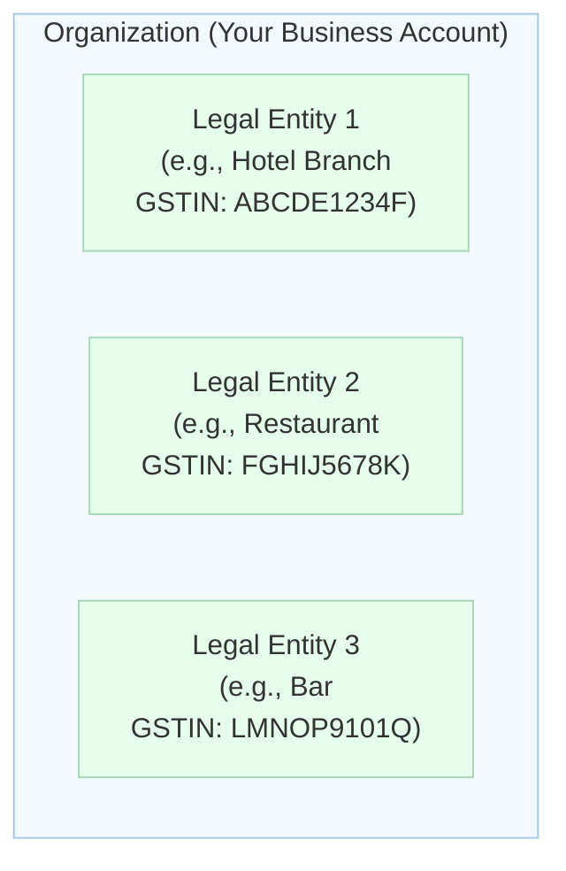
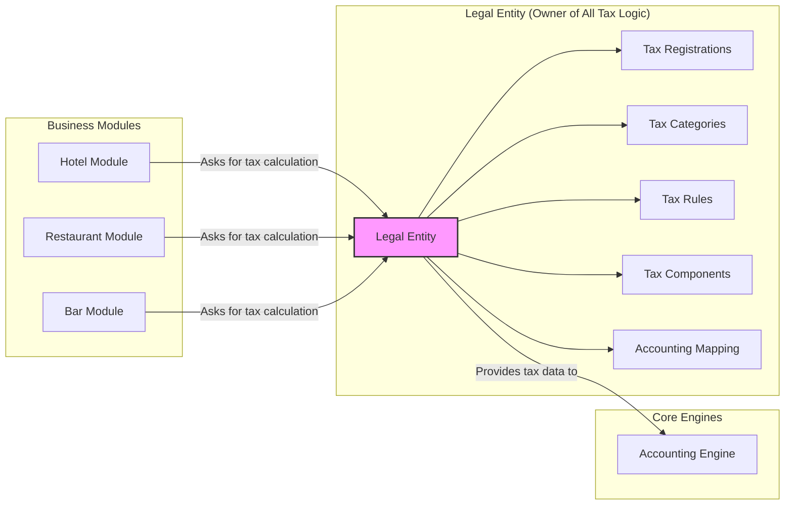
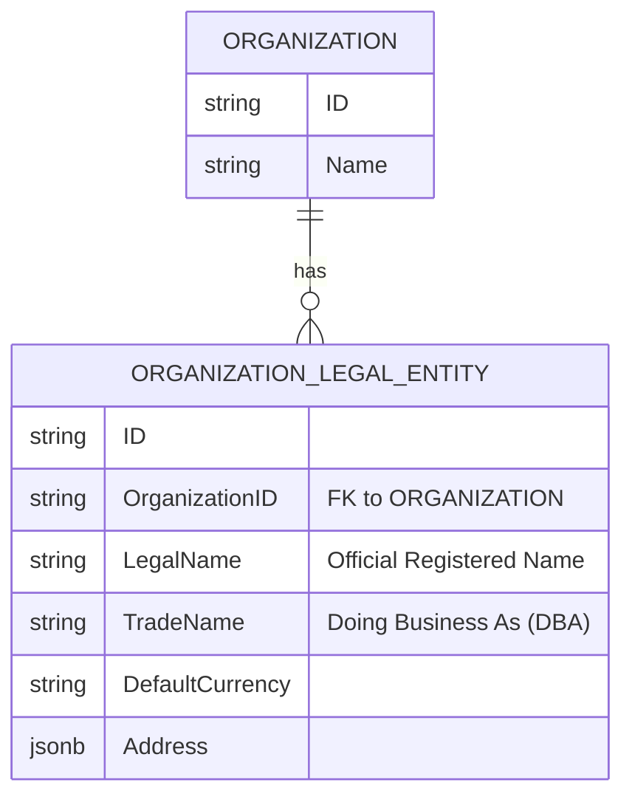

# Legal Entity & Tax Engine — A Simple Guide

This guide explains the architecture and design of the Legal Entity and Tax Engine in simple terms.

---

## 1. What is a Legal Entity?

Think of a **Legal Entity** as the "official" business that the government recognizes. It's the part of your business that is legally responsible for:

- **Paying taxes** (it has official tax numbers like a GSTIN).
- **Following laws and regulations** (compliance).
- **Filing official reports** (tax returns).
- **Keeping financial records** (revenue, tax liability, etc.).

In the real world, this could be your registered company, a partnership, or even a specific branch with its own tax ID.

> ### Organization vs. Legal Entity
>
> - An **Organization** is your main account or tenant in the system. It's a container for all your business operations.
> - A **Legal Entity** is the actual business unit registered with the government.
>
> You can have **multiple** Legal Entities under **one** Organization.

### Visualized:

---

## 2. Why Do We Need Legal Entities?

A single organization might run several different businesses. Each of these might need its own separate tax registration.

**Example:**
Imagine a company, "Sunrise Hospitality," runs a hotel, a restaurant, and a bar.

- The Hotel has its own tax number (**GSTIN A**).
- The Restaurant has a different tax number (**GSTIN B**).
- The Bar also has its own tax number (**GSTIN C**).

In our system, "Sunrise Hospitality" is the **Organization**, but it contains **three separate Legal Entities** (the hotel, restaurant, and bar) because each one handles its taxes independently.

This setup allows the system to:

- Apply different tax rates for services at the hotel vs. the bar.
- Manage separate accounting books for each business.
- Ensure each business unit complies with its specific legal requirements.

---

## 3. The Ownership Model

This is the most important rule for how taxes are managed in the system.

> 👉 **The Legal Entity ALWAYS owns all tax logic.**

Modules like `Hotel`, `Restaurant`, or even `Accounting` **NEVER** define or control tax rules. They only ask the Legal Entity's Tax Engine, "How much tax should I apply?"

### How it Works:

---

## 4. Core Data Tables

This is how we store this information in the database.

### `LegalEntity`

This table represents a legally registered business and links it to an Organization account.

- **Purpose:** To store the details of each official business unit.
- **Key Fields:**
  - `LegalName`: The name on official government documents.
  - `TradeName`: The name the business uses publicly (e.g., "The Downtown Grill").
  - `OrganizationID`: Links the entity back to the main organization account.
