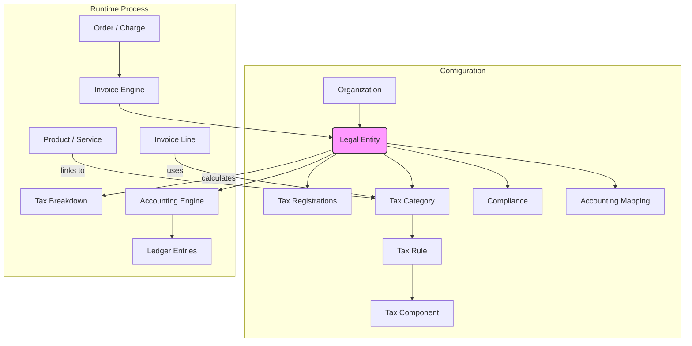

# Legal Entity (Tax Engine)

The Legal Entity module, also referred to as the Tax Engine in sharpnr, is responsible for determining which taxes apply to various products and services. It manages tax registrations, categories, rules, and compliance for an organization.

## Component Hierarchy

This section outlines the structural relationship between the different components of the Tax Engine.

### High-Level Structure

```
Organization
└── LegalEntity
    ├── Tax Registrations
    ├── Tax Categories
    ├── Tax Rules
    ├── Tax Components
    ├── Compliance
    └── Accounting Mapping
```

### Detailed Breakdown

```
LegalEntity
 └── TaxCategory
       └── TaxRule
             └── TaxComponent
```

## Process Flow

The following diagram illustrates how the Tax Engine processes an order or charge to calculate taxes and record them in the accounting system.

```
Order / Charge
   ↓
InvoiceEngine
   ↓
Tax Engine (Legal Entity)
   ↓
Tax Breakdown (CGST, SGST, VAT, etc.)
   ↓
Accounting Engine
   ↓
Ledger Entries
```

## Mermaid Diagram

This diagram provides a visual representation of the relationships and flows within the Tax Engine.



### Linking Product to Taxation

A product or service is associated with a `TaxCategory` to determine the set of applicable tax rules.

```
Product / Service
 └── TaxCategoryID
```

During invoicing, the `TaxCategoryID` from the invoice line item is used to apply the correct tax rules and components.

```
InvoiceLine
 └── TaxCategoryID
       └── TaxRule
             └── TaxComponent
```