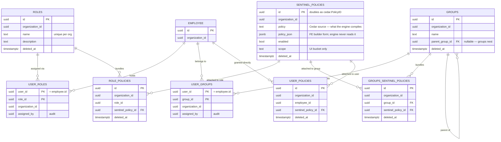
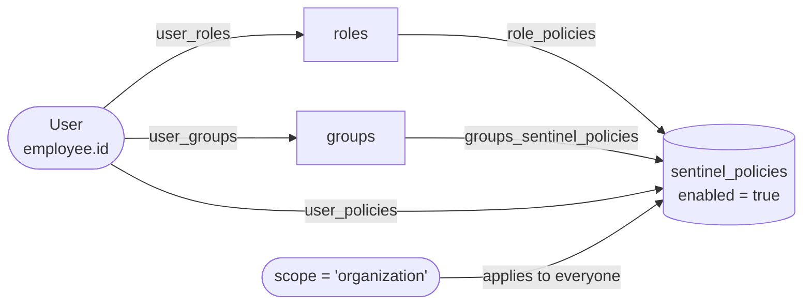

# Sentinel — Data Model

Everything here lives in the **`sentinel_engine`** Postgres schema.

Sentinel is split in two halves that share these tables:

| Half | Package | Job |
|---|---|---|
| **Authoring** | `sentinel/` | CRUD over policies, roles, groups and their attachments. What the policy-builder UI talks to. |
| **Evaluation** | `sentinel_engine/` | Compiles a user's effective policies into a Cedar `PolicySet` and answers allow/deny. |

The authoring side writes these tables. The engine only ever **reads** them, through one query (`GetAllPoliciesOfUser`).

---

## Tables

`EMPLOYEE` is `employee.employee` and lives outside this schema — there is no
FK to it. `user_id` and `employee_id` both mean `employee.employee.id`; the
inconsistent naming is historical.

---

## How a policy reaches a user

A policy applies to whoever it is **attached** to. There are four independent
paths, and a user's effective set is their **union**:

That union is one SQL statement — `sentinel/repo/engine_store.go`,
`GetAllPoliciesOfUser`. It filters on `organization_id`, `enabled = TRUE`,
`deleted_at IS NULL`, then `scope = 'organization' OR EXISTS(...)` across the
three attachment paths.

The result is compiled into a Cedar `PolicySet` and cached per **`(orgID,
userID)`** with a TTL. Any change to a policy or an attachment must invalidate
that cache, or the change silently does not take effect until the TTL lapses.

---

## Evaluation, briefly

`sentinel_engine/engine.go` does, in order:

1. **Structural tenant check.** If `Resource.OrgID` is set and differs from the
   request's org → **deny before any policy runs**. Policies can only ever widen
   access *within* an org, never across one.
2. Load the user's effective policies (cached).
3. Build the request: principal `User::"<employee-uuid>"`, action
   `Action::"<action-name>"`, resource `<Type>::"<id>"`.
4. Evaluate.

**Type-level vs instance-level.** When `Resource.ID` is empty the engine
substitutes `anyResourceID`, which is `"*"` — so a type-level check evaluates
against `CostCenter::"*"`. This is what separates "all instances" from "one
instance":

| Cedar form | Matches `CostCenter::"*"`? | Means |
|---|---|---|
| `permit(principal, action, resource);` | yes | every instance |
| `permit(..., resource is CostCenter);` | yes | every cost center |
| `permit(..., resource == CostCenter::"<uuid>");` | no | that one instance |

The middle form reads like "scoped" to a human but grants everything. A policy
builder emitting it where the third form was intended silently over-grants.

**Engine-owned attributes.** `principal.orgId` and `resource.orgId` are stamped
by the engine itself and override anything the caller passed, so authored
`when { resource.orgId == principal.orgId }` guards can't be forged and never
error on a missing attribute.

---

## Invariants and gotchas

**Roles and Groups are *not* Cedar entities.** This is the most important thing
to know. `buildEntities` puts exactly two entities in the map — the principal
(`User::"<uuid>"`) and the resource. There is no `Role::` or `Group::` entity
and no parent hierarchy. A policy written `principal == Role::"Manager"` will
**never match**. Roles and groups are *attachment mechanisms* resolved in SQL,
not principals resolved in Cedar. Policy text should leave the principal
unconstrained and let attachment decide applicability — which is exactly what
the seeded Owner policy does (`sentinel/service/defaults.go`).

> ⚠️ The doc comment on `Role` in `roles.go` still claims Name is "the Cedar
> entity id" referenced as `Role::"<name>"`. That is stale and describes a
> design that was never wired.

**`scope` is a UI label, not enforcement.** It buckets policies for the admin UI
(organization / role / group / user). The one place it *does* affect behaviour is
`scope = 'organization'`, which the union query treats as "applies to everyone".

> ⚠️ The comment on `PolicyScope` in `policy.go` says the engine "still loads
> every enabled org policy" and that attachment-driven evaluation is future
> work. That is stale — `GetAllPoliciesOfUser` has filtered by attachment since
> migration 000034.

**Membership edges are hard-deleted; attachment edges are soft-deleted.**
`user_roles` and `user_groups` have a composite PK `(user_id, role_id)` /
`(user_id, group_id)` and **no `deleted_at`** — removing someone deletes the row.
`role_policies`, `groups_sentinel_policies` and `user_policies` carry
`deleted_at` and use a **partial unique index** `WHERE deleted_at IS NULL`, so a
soft-deleted attachment doesn't block re-attaching the same pair.

**Cascades exist only from policies and groups.** The three attachment tables
have real FKs to `sentinel_policies(id) ON DELETE CASCADE`, and
`groups_sentinel_policies` also cascades from `groups(id)`. Everything else —
`user_roles.role_id`, `role_policies.role_id` — has **no FK**, matching the
repo-wide convention. Deleting a role does not clean up its edges; the service
layer must.

**Policy text is immutable-by-convention.** `SentinelPolicy.ID` doubles as the
`cedar.PolicyID` so authorization diagnostics trace back to the row. Resource
types and action names are embedded in stored policy text as strings, so once
released they must stay stable — renaming `canViewProperty` silently breaks every
policy that mentions it.

**`policy_engine` is dead.** Migration `000026` created a permission-grid RBAC
design (`policy_engine.role`, `.permission`, `.employee_role`). It was replaced by
this Cedar model in `000027` and dropped in `000028`. If you find references to
it, they are historical.

---

## Provisioning

`sentinel/service/provision.go` seeds a new org in one transaction: an **Owner**
role, a full-access policy (`permit(principal, action, resource);`), the
role↔policy attachment, the founding employee's role assignment, and a
**Stakeholders** group. Idempotent — if the Owner role exists, the org is
considered provisioned.

> ⚠️ `AssignRoleToUser` and `AssignUserToGroup` are called **only** from here.
> There is no service method or endpoint to assign a role to any subsequent
> employee, so every employee except the founder currently has an empty policy
> set and is denied everything by a guarded endpoint. Closing that gap is a
> prerequisite for adopting Sentinel in any new module.

---

## File map

| File | Tables |
|---|---|
| `roles.go` | `roles`, `role_policies` |
| `groups.go` | `groups`, `groups_sentinel_policies`, `user_roles`, `user_policies`, `user_groups` |
| `policy.go` | `sentinel_policies`, `PolicyScope` |

`groups.go` holds the three user-edge tables for historical reasons, not because
they are group-related.

## Migrations

| # | What |
|---|---|
| `000026` | old `policy_engine` RBAC grid (superseded) |
| `000027` | `roles`, `groups`, `sentinel_policies`, `user_roles`, `user_groups` |
| `000028` | drops `policy_engine` |
| `000034` | `role_policies`, `user_policies` |
| `000037` | drops `roles.slug` |
| `000039` | drops `groups.slug` |
| `000040` | `groups_sentinel_policies` |
