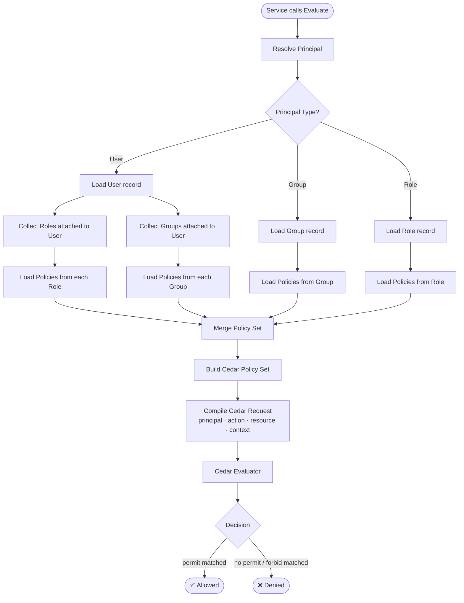
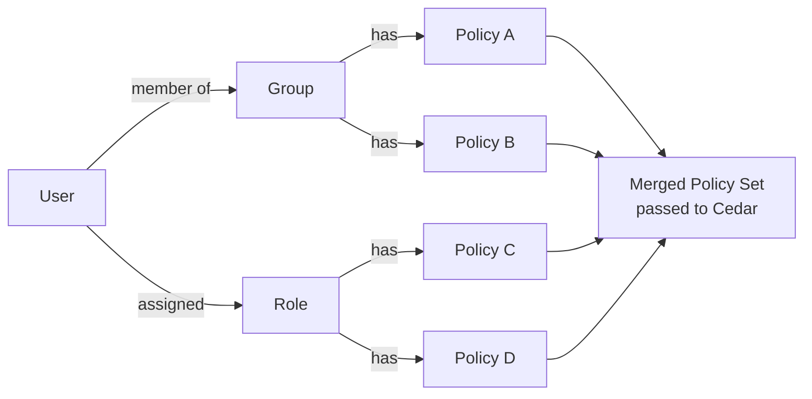
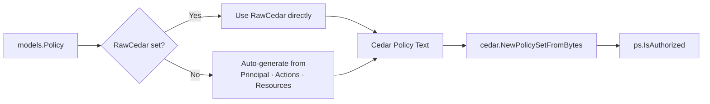
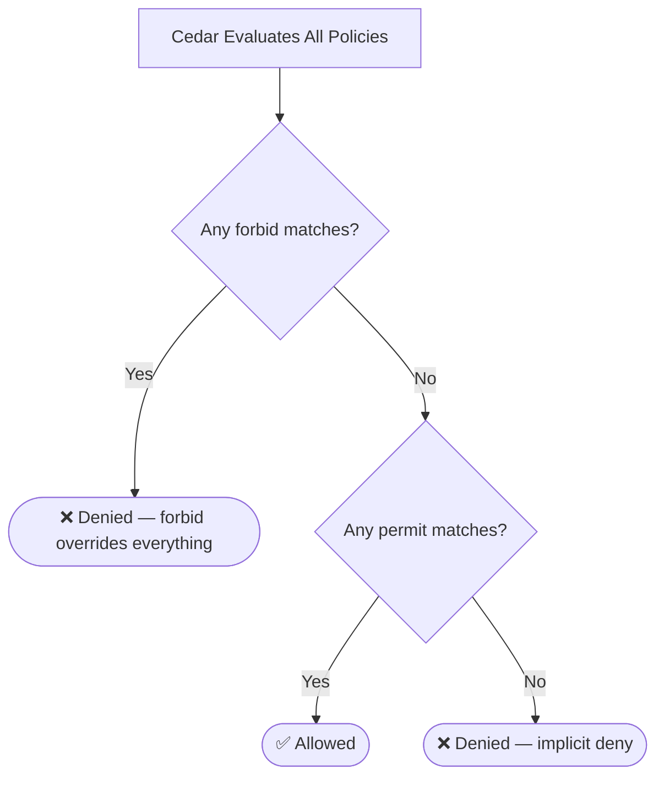

# Sentinel Engine — How It Works

> `engine/sentinel.go` · `evaluator/evaluator.go`

---

## Overview

When a SharpNR service needs to check if a user can perform an action, it calls `sentinel.Evaluate()`. The engine then:

1. Resolves all policies that apply to the given principal (via roles and groups)
2. Builds a Cedar policy set from those policies at runtime
3. Constructs the Cedar request (principal + action + resource + context)
4. Runs the Cedar evaluator and returns `Allowed` or `Denied`

The **resource tree is never persisted**. It is assembled in-memory at evaluation time from the incoming request. This is intentional — Cedar's evaluation is fast enough that pre-computing or caching resource trees adds complexity without meaningful performance benefit.

---

## Evaluation Flow



---

## Policy Resolution

Policies never attach directly to a User. They flow through **Roles** and **Groups**:



This means a user inherits all policies from every group they belong to and every role assigned to them. The merged set is evaluated together — if **any** policy permits the action, the result is `Allowed` (unless a `forbid` policy overrides it, which always wins in Cedar).

---

## Cedar Policy Lifecycle

Each `models.Policy` has a `RawCedar` field. If it is set, the engine uses it verbatim. If it is empty, the engine auto-generates Cedar text from the structured fields (`Principal`, `Actions`, `Resources`).



### Example: Auto-generated Cedar output

Given this policy:

```go
utils.NewPolicy("engineer-read-docs").
    Permit().
    ForRole("engineer").
    AllowActions("read", "list").
    OnResourceType("Document").
    Build()
```

The engine generates:

```cedar
// Policy: engineer-read-docs
permit(
  principal == Role::"engineer",
  action in [Action::"read", Action::"list"],
  resource is Document
);
```

---

## Forbid Always Wins

Cedar uses a **default-deny** model with an **explicit forbid override**:



This means:
- No policy = **denied**
- At least one `permit` and no `forbid` = **allowed**
- Any `forbid` = **denied**, even if a `permit` also matches

---

## Runtime Resource Tree

SharpNR does **not** store what resources exist at a given moment. The resource identity (`ResourceType` + `ResourceID`) is passed in the evaluation request by the calling service. Cedar validates against the policy's resource clause at that moment.

This keeps Sentinel stateless with respect to resources — the calling service is the source of truth for what resource is being acted upon.

---

## Entry Point

```go
// engine/sentinel.go
func Boot() service.SentinelService {
    return service.New()
}
```

`Boot()` is the only function you need to call. It wires together the in-memory stores and the Cedar evaluator and returns a fully ready `SentinelService`.

---

## Related Docs

- [Introduction](./intro.md)
- [Models Reference](./models.md)
- [Service & Injection Guide](./service.md)