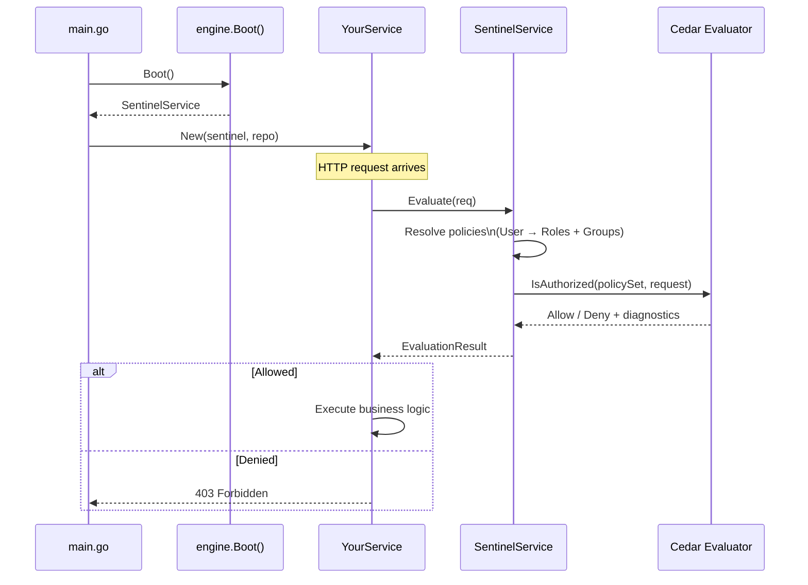

# Sentinel Engine — Service & Injection Guide

> `service/interface.go` · `service/constructor.go` · `engine/sentinel.go`

---

## The SentinelService Interface

`SentinelService` is the single interface you import into other SharpNR services. It covers everything: evaluation, and full CRUD for policies, users, groups, and roles.

```go
type SentinelService interface {
    // Authorization
    Evaluate(ctx, EvaluationRequest) (*EvaluationResult, error)

    // Policy management
    CreatePolicy / GetPolicy / ListPolicies / UpdatePolicy / DeletePolicy

    // User management
    CreateUser / GetUser / ListUsers / UpdateUser / DeleteUser

    // Group management
    CreateGroup / GetGroup / ListGroups
    AddUserToGroup / RemoveUserFromGroup

    // Role management
    CreateRole / GetRole / ListRoles
    AssignRoleToUser / RevokeRoleFromUser

    // Attachment
    AttachPolicyToGroup / DetachPolicyFromGroup
    AttachPolicyToRole  / DetachPolicyFromRole
}
```

---

## Injecting Sentinel Into a Service

### 1. Boot the engine (once at startup)

```go
import "github.com/sharpnr/sentinel_engine/engine"

sentinel := engine.Boot()
```

### 2. Pass it to your service constructor

```go
// your service
type DocumentService struct {
    sentinel service.SentinelService
    repo     DocumentRepo
}

func NewDocumentService(sentinel service.SentinelService, repo DocumentRepo) *DocumentService {
    return &DocumentService{sentinel: sentinel, repo: repo}
}
```

### 3. Call Evaluate before every protected operation

```go
func (s *DocumentService) GetDocument(ctx context.Context, userID, docID string) (*Document, error) {
    result, err := s.sentinel.Evaluate(ctx, service.EvaluationRequest{
        PrincipalType: "User",
        PrincipalID:   userID,
        Action:        "read",
        ResourceType:  "Document",
        ResourceID:    docID,
    })
    if err != nil {
        return nil, err
    }
    if !result.Allowed {
        return nil, ErrForbidden
    }

    return s.repo.FindByID(ctx, docID)
}
```

---

## EvaluationRequest

```go
type EvaluationRequest struct {
    PrincipalType string            // "User", "Group", "Role"
    PrincipalID   string            // ID of the principal
    Action        string            // action being attempted, e.g. "delete"
    ResourceType  string            // Cedar entity type, e.g. "Document"
    ResourceID    string            // ID of the resource
    Context       map[string]string // optional — for ABAC conditions
}
```

### Using Context for ABAC

Pass runtime attributes in `Context` when your Cedar policies use `when` conditions:

```go
service.EvaluationRequest{
    PrincipalType: "User",
    PrincipalID:   "bob",
    Action:        "approve",
    ResourceType:  "Invoice",
    ResourceID:    "inv-1042",
    Context: map[string]string{
        "invoice_amount": "4500",
        "department":     "finance",
    },
}
```

---

## EvaluationResult

```go
type EvaluationResult struct {
    Allowed    bool   // true = access granted
    Reason     string // human-readable match reason
    Diagnostic string // Cedar diagnostic — which policy matched (or errors)
}
```

---

## Full Injection Flow



---

## Setting Up Policies at Boot

For seeding initial policies when a service starts, use the `utils.PolicyBuilder` to keep it readable:

```go
import "github.com/sharpnr/sentinel_engine/utils"

func seedPolicies(ctx context.Context, sentinel service.SentinelService) error {
    policies := []models.Policy{
        utils.NewPolicy("admin-full-access").
            Permit().
            ForRole("admin").
            AllowActions("read", "write", "delete", "list").
            OnResourceType("Document").
            Build(),

        utils.NewPolicy("viewer-read-only").
            Permit().
            ForRole("viewer").
            AllowActions("read", "list").
            OnResourceType("Document").
            Build(),

        utils.NewPolicy("block-external-delete").
            Forbid().
            ForGroup("external-contractors").
            AllowActions("delete").
            OnResourceType("Document").
            Build(),
    }

    for _, p := range policies {
        p := p
        if err := sentinel.CreatePolicy(ctx, &p); err != nil {
            return err
        }
    }
    return nil
}
```

---

## Swapping the Storage Backend

The current `constructor.go` uses in-memory maps. To plug in Postgres, MongoDB, or any other store, implement `SentinelService` with your own repository layer:

```go
// your db-backed implementation
type dbSentinelService struct {
    policyRepo PolicyRepository
    userRepo   UserRepository
    groupRepo  GroupRepository
    roleRepo   RoleRepository
    evaluator  *evaluator.CedarEvaluator
}

func NewWithDB(db *sql.DB) service.SentinelService {
    return &dbSentinelService{
        policyRepo: postgres.NewPolicyRepo(db),
        userRepo:   postgres.NewUserRepo(db),
        groupRepo:  postgres.NewGroupRepo(db),
        roleRepo:   postgres.NewRoleRepo(db),
        evaluator:  evaluator.New(),
    }
}
```

The `evaluator.CedarEvaluator` is storage-agnostic — it only needs the resolved `[]*models.Policy` slice. All storage concerns stay outside it.

---

## Related Docs

- [Introduction](./intro.md)
- [How the Engine Works](./engine.md)
- [Models Reference](./models.md)