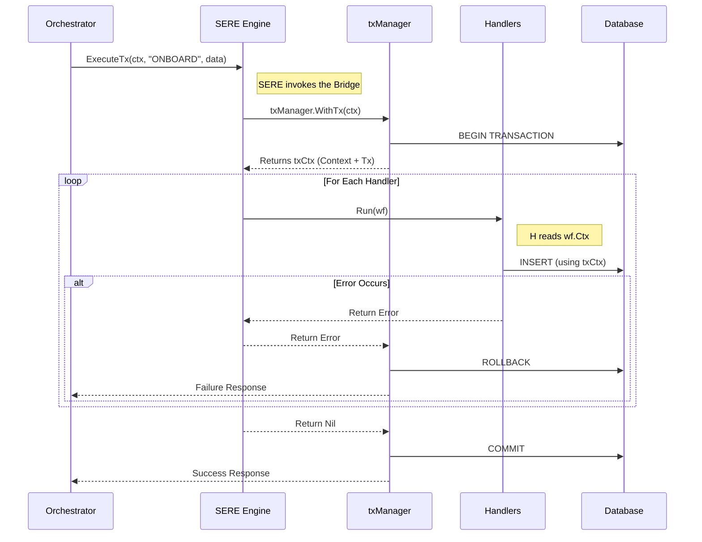

Here is the complete, single-file `README.md` documentation. You can copy this directly into your project as `WORKFLOW_README.md`.

---

```markdown
# SERE Transactional Workflow Engine: Developer Guide

## 📖 Introduction: The "Atomic" Problem

In our modular architecture (e.g., Hospitality, Accounting, Organization), a single user action often requires updates across multiple modules.

**The Scenario: Onboarding a New Client**
1.  **Organization Module:** Creates the Organization record.
2.  **Accounting Module:** Creates the Accounting Book, Fiscal Year, and Ledgers.
3.  **Identity Module:** Creates the Admin User.

**The Risk:**
If Step 1 succeeds (Org created) but Step 2 fails (Database error in Accounting), you are left with a **"Zombie Organization"**—it exists, but has no ledger to record money. This breaks data integrity.

**The Solution:**
We use **SERE (Workflow Engine)** combined with a **txManager (Transaction Manager)**. This allows us to wrap **multiple steps** across **different modules** into a single **Database Transaction**.

> **The Rule:** Either *everything* saves, or *nothing* saves.

---

## 🏗 Architecture Overview

We use a **Bridge Pattern** to connect our Event Engine (SERE) with our Database Layer (GORM) without tightly coupling them.

1.  **The Bridge (`UseTxExecutor`):** Tells SERE *how* to start a transaction.
2.  **The Carrier (`Context`):** The active transaction is hidden inside Go's `context.Context`.
3.  **The Workflow:** A chain of functions (Handlers) that execute sequentially inside that context.

### Visual Flow

```mermaid
graph TD
    subgraph "Orchestrator Service"
        Start[Start Onboarding] --> CallSERE[Call SERE.ExecuteTx]
    end

    subgraph "Infrastructure (The Bridge)"
        CallSERE --> TxMgr[txManager: Start DB Transaction]
        TxMgr --> Inject[Inject Transaction into Context]
        Inject --> SERE_Loop[SERE: Run Handlers Loop]
    end

    subgraph "The Workflow (Inside Transaction)"
        SERE_Loop --> H1[Handler 1: Create Org]
        H1 -->|Writes to DB using txCtx| DB[(Database)]
        H1 -->|Passes Data via wf.Data| H2[Handler 2: Create Accounting]
        H2 -->|Writes to DB using txCtx| DB
    end

    H2 --> Decision{Success?}
    Decision -- Yes --> Commit[Commit Transaction (Save All)]
    Decision -- No --> Rollback[Rollback Transaction (Undo All)]

```

---

## 🚀 Step-by-Step Implementation Guide

Follow these 4 steps to add a new transactional workflow to the system.

### Step 1: The Bridge (Bootstrap)

*Done once in `app.go` or `bootstrap.go`.*

This connects the `txManager` to `SERE`.

```go
// bootstrap.go
func BootstrapModules(...) {
    // ... initialize services ...

    // Teach SERE how to use GORM Transactions
    sereEngine.UseTxExecutor(func(ctx context.Context, fn func(ctx context.Context) error) error {
        // Wrap the SERE logic 'fn' inside our txManager
        return txManager.WithTx(ctx, func(tx *gorm.DB) error {
            // Inject the transaction into the context so handlers can find it
            txCtx := dbtx.InjectTx(ctx, tx)
            return fn(txCtx) 
        })
    })
}

```

### Step 2: Define Handlers

Handlers are isolated functions. They don't know about each other; they only know about `wf.Data` and `wf.Ctx`.

**Handler A: Create Organization**

```go
func OrgCreationHandler(orgService org.Service) sere.WorkflowHandler {
    return func(wf *sere.Workflow) error {
        // 1. Extract inputs
        name := wf.Data["entity_name"].(string)

        // 2. Execute Logic (PASS THE CONTEXT!)
        // wf.Ctx holds the transaction.
        org, err := orgService.CreateOrg(wf.Ctx, name)
        if err != nil {
            return err // Triggers ROLLBACK
        }

        // 3. Share Data for next steps
        wf.Data["org_id"] = org.ID
        return nil
    }
}

```

**Handler B: Setup Accounting**

```go
func AccountingSetupHandler(accService accounting.Service) sere.WorkflowHandler {
    return func(wf *sere.Workflow) error {
        // 1. Get shared data from previous step
        orgID, ok := wf.Data["org_id"].(uuid.UUID)
        if !ok {
            return fmt.Errorf("workflow error: org_id not found")
        }

        // 2. Run Accounting Logic
        input := &contracts.DraftAccountingSetupInput{OrgID: orgID}
        
        // This runs inside the SAME transaction as Handler A
        return accService.CreateDraftAccountingSetup(wf.Ctx, input)
    }
}

```

### Step 3: Register the Workflow

Group your handlers under a specific event name.

```go
// app/bootstrap.go
func RegisterAllWorkflows(s *sere.SERE, orgSvc org.Service, accSvc acc.Service) {
    
    // Define the "ONBOARD_ORGANIZATION" pipeline
    s.SubscribeWorkflow("ONBOARD_ORGANIZATION", 
        workflows.OrgCreationHandler(orgSvc),     // Step 1
    )
    
    s.SubscribeWorkflow("ONBOARD_ORGANIZATION", 
        workflows.AccountingSetupHandler(accSvc), // Step 2
    )
}

```

### Step 4: Execute the Workflow

Trigger the process from your Orchestrator or API Handler.

```go
// services/orchestrator.go
func (s *Orchestrator) OnboardClient(ctx context.Context, req ClientRequest) error {
    
    // Initial data for Step 1
    data := map[string]any{
        "entity_name": req.Name,
        "email":       req.Email,
    }

    // 🔥 ExecuteTx: Runs all handlers in one atomic transaction
    _, err := s.sere.ExecuteTx(ctx, "ONBOARD_ORGANIZATION", data)
    
    if err != nil {
        // If we are here, NO data was saved. The DB is clean.
        return fmt.Errorf("onboarding failed: %w", err)
    }

    return nil
}

```

---

## 🔍 Sequence Diagram (Under the Hood)

This details the call stack during execution.



---

## 🛠 Developer Cheatsheet

### 1. The Context (`wf.Ctx`)

* **What is it?** The "Backpack" carrying the database transaction.
* **Rule:** You **MUST** pass `wf.Ctx` to every service or repository call inside a handler.
* **Mistake:** If you pass `context.Background()`, your data will save instantly and won't roll back on failure.

### 2. The Shared Data (`wf.Data`)

* **What is it?** A `map[string]any` shared across all handlers in the workflow.
* **Usage:** Use it to pass IDs generated in Step 1 to Step 2.
* **Safety:** Always check if the key exists before casting (e.g., `val, ok := wf.Data["key"]`).

### 3. Debugging

* **"Record not found" inside workflow:** You likely forgot to pass `wf.Ctx` to the repository, so it's looking in the main DB table instead of the uncommitted transaction.
* **"Transaction didn't rollback":** Did your handler return `nil` even though an error occurred? You must return the `error` for the rollback to trigger.

---

```

```